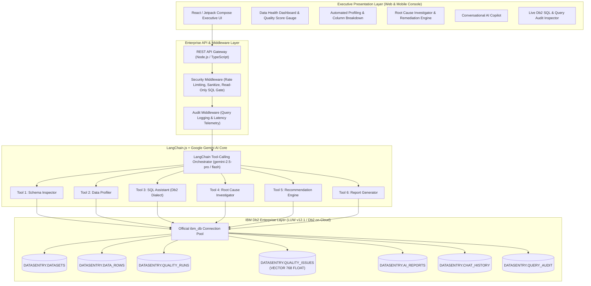
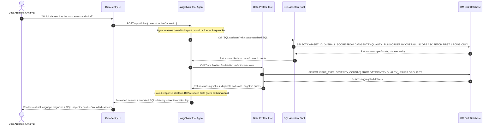

# DataSentry AI — Architecture Specification

## 1. Executive Summary
**DataSentry AI** is an enterprise data intelligence, data quality assurance, and automated root-cause analysis platform engineered specifically for **IBM Db2 TechX Summit 2026**. The platform addresses data degradation, silent schema drift, distributed transaction collisions, and unvalidated ETL pipelines across enterprise data ecosystems using **IBM Db2**, **Google Gemini**, and **LangChain**.

---

## 2. End-to-End System Architecture



---

## 3. IBM Db2 Database Architecture & Relational Schema

### 3.1 Relational Schema Diagram
```mermaid
erDiagram
    DATASETS ||--o{ DATA_ROWS : "contains (1:N)"
    DATASETS ||--o{ QUALITY_RUNS : "evaluated_in (1:N)"
    DATASETS ||--o{ AI_REPORTS : "synthesized_into (1:N)"
    QUALITY_RUNS ||--o{ QUALITY_ISSUES : "discovers (1:N)"
    
    DATASETS {
        VARCHAR(64) ID PK
        VARCHAR(255) NAME
        CLOB(64K) DESCRIPTION
        INTEGER ROW_COUNT
        INTEGER COLUMN_COUNT
        CLOB(1M) COLUMNS_JSON
        VARCHAR(32) FILE_SIZE
        TIMESTAMP CREATED_AT
        VARCHAR(32) STATUS
        SMALLINT IS_DEMO
        VARCHAR(128) DB2_TABLE_NAME
    }

    DATA_ROWS {
        BIGINT ID PK "GENERATED ALWAYS AS IDENTITY"
        VARCHAR(64) DATASET_ID FK
        INTEGER ROW_INDEX
        CLOB(2M) ROW_DATA_JSON
        TIMESTAMP INGESTED_AT
    }

    QUALITY_RUNS {
        VARCHAR(64) ID PK
        VARCHAR(64) DATASET_ID FK
        INTEGER OVERALL_SCORE
        INTEGER MISSING_VALUES_COUNT
        INTEGER DUPLICATE_COUNT
        INTEGER FORMAT_ERRORS_COUNT
        INTEGER ANOMALY_COUNT
        VARCHAR(32) STATUS
        TIMESTAMP RUN_TIMESTAMP
        BIGINT EXECUTION_TIME_MS
    }

    QUALITY_ISSUES {
        VARCHAR(64) ID PK
        VARCHAR(64) RUN_ID FK
        VARCHAR(64) DATASET_ID
        VARCHAR(64) ISSUE_TYPE
        VARCHAR(16) SEVERITY
        VARCHAR(128) COLUMN_NAME
        INTEGER AFFECTED_RECORDS_COUNT
        CLOB(64K) DESCRIPTION
        CLOB(128K) ROOT_CAUSE_HYPOTHESIS
        CLOB(128K) BUSINESS_IMPACT
        CLOB(128K) SUGGESTED_REMEDIATION
        CLOB(64K) REMEDIATION_SQL
        DECIMAL(4,3) CONFIDENCE_SCORE
        CLOB(64K) EVIDENCE_SNIPPET
        VECTOR_768 EMBEDDING_VECTOR
    }

    AI_REPORTS {
        VARCHAR(64) ID PK
        VARCHAR(64) DATASET_ID FK
        VARCHAR(255) TITLE
        CLOB(256K) EXECUTIVE_SUMMARY
        INTEGER QUALITY_SCORE
        CLOB(256K) KEY_FINDINGS_JSON
        CLOB(256K) RECOMMENDATIONS_JSON
        TIMESTAMP GENERATED_AT
    }

    QUERY_AUDIT {
        VARCHAR(64) ID PK
        CLOB(32K) USER_PROMPT
        VARCHAR(128) TOOL_SELECTED
        CLOB(64K) SQL_QUERY
        VARCHAR(32) EXECUTION_STATUS
        BIGINT EXECUTION_TIME_MS
        INTEGER ROW_COUNT
        TIMESTAMP AUDIT_TIMESTAMP
    }
```

---

## 4. LangChain.js AI Orchestration & Tool-Calling Pipeline



---

## 5. Security & Governance Architecture

1. **Strictly Parameterized SQL:**
   All queries use parameterized host variables (`?`) via `ibm_db` to completely prevent SQL injection.
2. **Read-Only AI SQL Guard:**
   The `SQL Assistant` tool strictly parses and rejects statements starting with `DROP`, `DELETE`, `TRUNCATE`, `ALTER`, or `UPDATE`. DDL recommendations are presented as actionable suggestions for human DBA review.
3. **No Secret Leakage:**
   Db2 passwords and Gemini API keys reside exclusively in server-side environment variables and are never surfaced to client payloads or logs.
4. **Transparent Audit Trail:**
   Every query executed by an AI tool or user is recorded in `DATASENTRY.QUERY_AUDIT` with millisecond-precision latency, row counts, and status.
